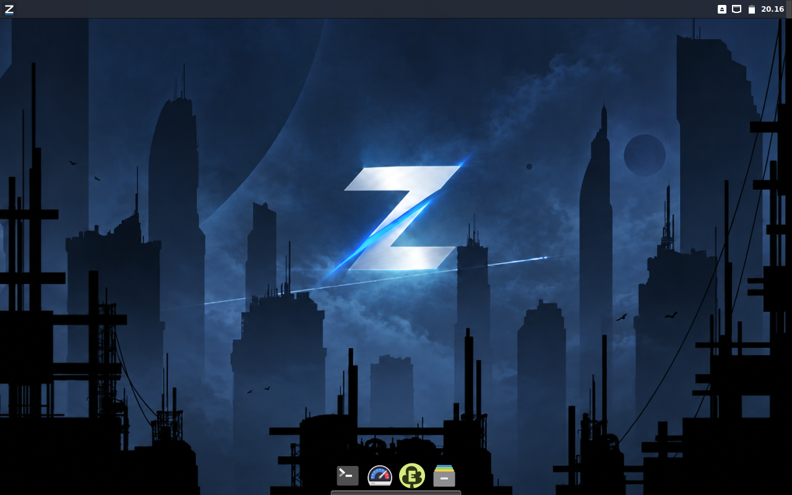
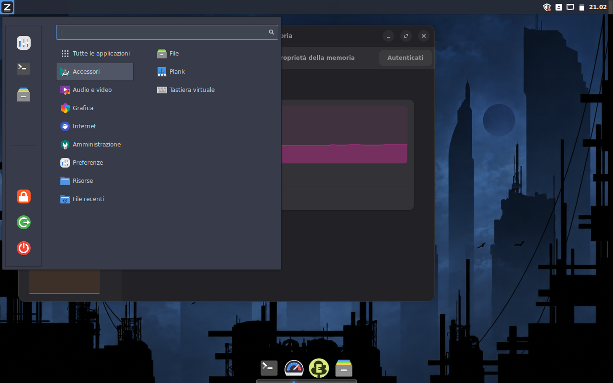
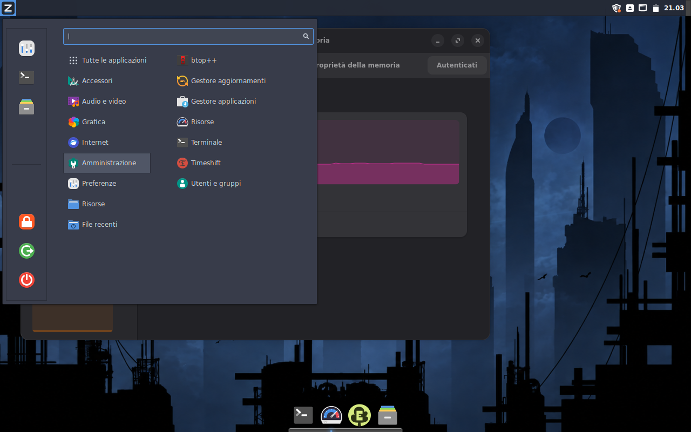
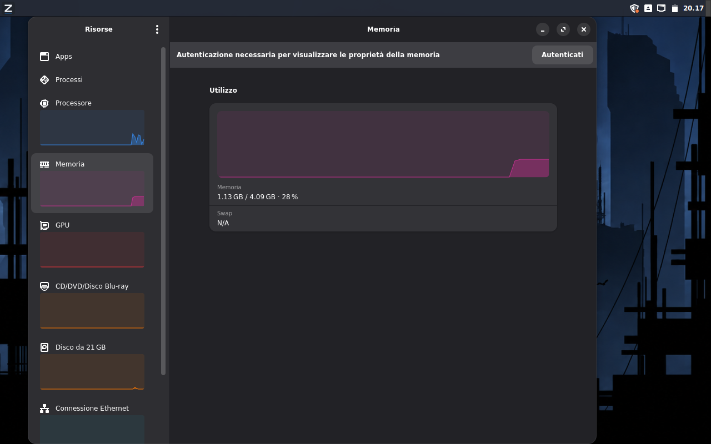
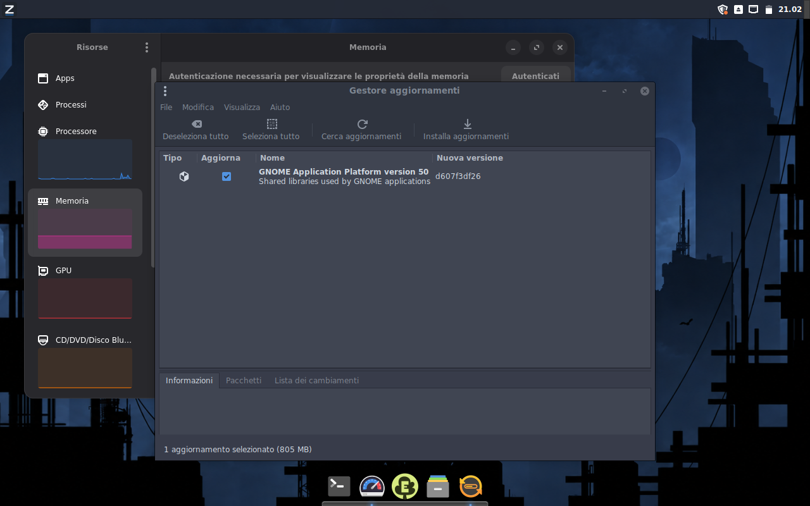
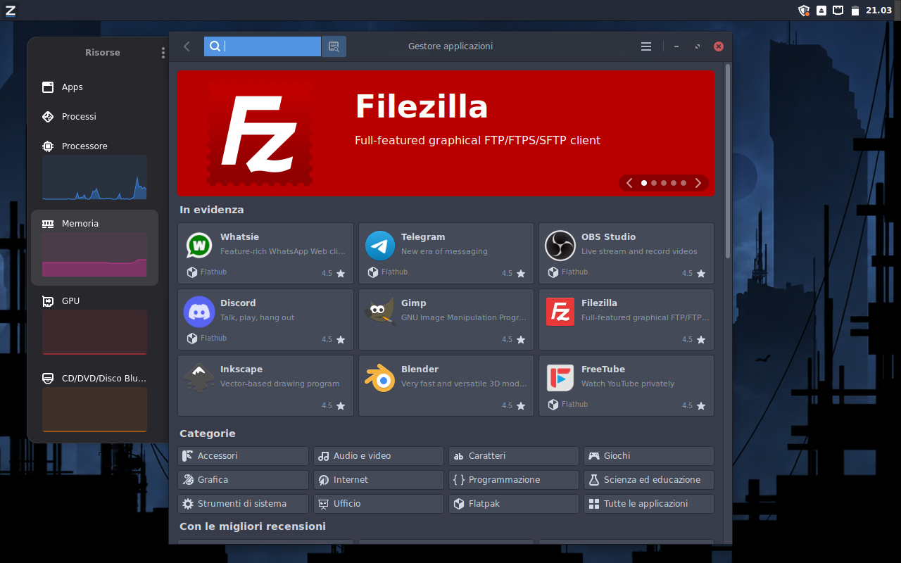
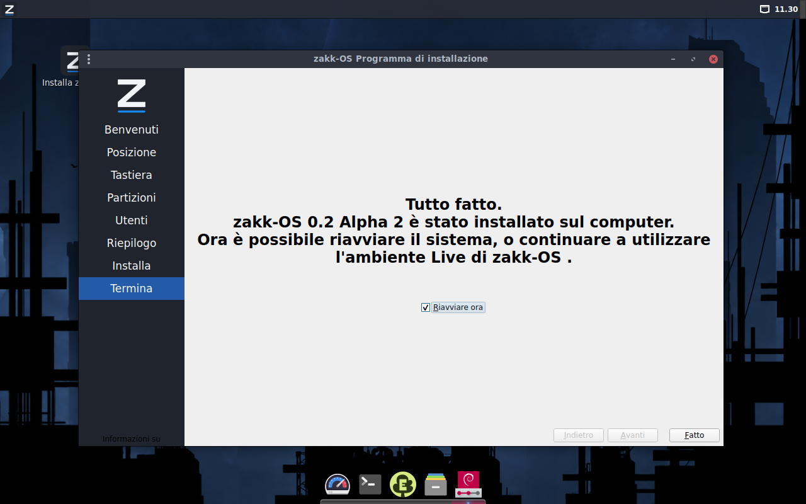

# zakk-OS

**Nasce per curiosità, cresce grazie alla condivisione e non prende ordini da nessuno.**

## ⚠️ NON È PER TUTTI. VERSIONE SPERIMENTALE. SOLO UEFI.

**Versione: 0.2.4-alpha — Experimental**

zakk-OS è una distribuzione Linux sperimentale basata su **Debian 13 Trixie (AMD64)**, con desktop **Cinnamon**.

È un progetto personale nato dalla curiosità di costruire un sistema operativo essenziale, personalizzabile e orientato all'homelab, al self-hosting e alla sperimentazione con l'intelligenza artificiale locale.

Non promette di rivoluzionare Linux, non pretende di sostituire le distribuzioni consolidate e non nasce per inseguire ogni possibile configurazione hardware.

L'obiettivo è semplice: realizzare una distribuzione funzionale, senza software superfluo, mantenendo il controllo sulle scelte tecniche.

**Non è una distribuzione stabile e non è destinata all'uso in produzione.**

## Screenshot

### Desktop Cinnamon



### Applicazioni e strumenti

| Menu applicazioni | Strumenti di amministrazione |
|:--:|:--:|
| [](screenshots/menu_app1.png) | [](screenshots/menu_app2.png) |

| Resources: monitoraggio del sistema | MintUpdate: aggiornamenti |
|:--:|:--:|
| [](screenshots/resources.png) | [](screenshots/mintupdate.png) |

### Gestione software e installazione

| MintInstall con Flathub | Calamares: installazione completata |
|:--:|:--:|
| [](screenshots/mintinstall.png) | [](screenshots/calamares.png) |

*Gli screenshot qui sopra provengono dai test della versione **0.2 Alpha 2** e sono mantenuti come riferimento visivo. Alcuni dettagli dell'interfaccia possono essere differenti nella versione 0.2.4-alpha.*

## Caratteristiche di zakk-OS 0.2.4-alpha

### Sistema e desktop

- Base **Debian 13 Trixie**, architettura **AMD64**.
- Kernel Linux **7.2.12** da Debian Backports.
- Desktop **Cinnamon 6.4**, personalizzato con tema scuro.
- Dock **Plank**.
- Barra Cinnamon con finestre raggruppate e indicatori di sistema.
- **Firefox ESR** come browser preinstallato.
- **Mousepad** come editor di testo, con schema di colori **Cobalt**.
- **Nemo** come file manager, con integrazione File Roller per la gestione degli archivi.
- **VLC**, **FFmpeg**, **gThumb**, **Flameshot**, **LocalSend** e altre utility essenziali.
- **Resources** per il monitoraggio del sistema.
- Interfaccia preconfigurata in italiano.

### Gestione software

- **APT** per i pacchetti Debian.
- **MintInstall** per la gestione grafica delle applicazioni.
- Supporto **Flatpak/Flathub**.
- **MintUpdate** per la gestione degli aggiornamenti.
- Repository Debian configurati con `main`, `contrib`, `non-free`, `non-free-firmware` e **Trixie Backports**.

### Hardware e connettività

- Firmware per diverse periferiche Intel, AMD, NVIDIA e Realtek.
- Inclusione dei pacchetti **intel-microcode** e **amd64-microcode**.
- Supporto Wi-Fi tramite NetworkManager e WPA Supplicant.
- Firmware Realtek aggiunto, incluso quello necessario alla **RTL8852BE**.
- Supporto GVfs per l'accesso alle condivisioni di rete.
- **Avahi** e mDNS per il rilevamento dei dispositivi nella rete locale.
- Stack audio **PipeWire**, **WirePlumber** e compatibilità PulseAudio/ALSA.

La presenza di firmware e driver non garantisce la compatibilità con ogni dispositivo esistente.

### Installazione

- Avvio e installazione **esclusivamente UEFI**.
- Installazione grafica tramite **Calamares**.
- Configurazione automatica dei repository Debian sul sistema installato.
- Personalizzazioni grafiche di GRUB e LightDM.

**BIOS Legacy/CSM non è supportato.**

## Download e installazione

**ATTENZIONE: VERSIONE ALPHA. EFFETTUARE UN BACKUP PRIMA DELL'INSTALLAZIONE.**

1. Scaricare la **[ISO zakk-OS 0.2.4-alpha](https://zakkos.it/download/zakk-OS_0.2.4-alpha.iso)**.
2. Scaricare il **[file SHA256](https://zakkos.it/download/zakk-OS_0.2.4-alpha.iso.sha256)**.
3. Verificare l'integrità dell'immagine ISO.
4. Preparare una chiavetta USB avviabile.
5. Avviare il computer in modalità UEFI.
6. Provare la sessione Live prima di procedere con l'installazione.
7. Avviare Calamares e seguire le indicazioni.

Per verificare il checksum su Linux:

```bash
sha256sum -c zakk-OS_0.2.4-alpha.iso.sha256
```

Su Windows, da PowerShell:

```powershell
Get-FileHash .\zakk-OS_0.2.4-alpha.iso -Algorithm SHA256
```

Il risultato deve coincidere con il valore contenuto nel file `.sha256`.

**L'installazione può cancellare definitivamente i dati presenti sul disco di destinazione.**

Si consiglia di provare inizialmente zakk-OS su una macchina virtuale o su un computer dedicato ai test.

Non utilizzare questa versione Alpha come unico sistema su cui conservare dati importanti.

## Hardware e test

zakk-OS viene sviluppata e verificata principalmente su hardware reale, con particolare attenzione alla compatibilità con piattaforme di generazioni differenti.

### Test delle versioni precedenti

- **VirtualBox** con avvio UEFI.
- **AMD Ryzen 5 3500X + NVIDIA RTX 2060 SUPER**, test Alpha 2.
- **Intel X79 / Xeon + NVIDIA GeForce GTX 1650**, test Alpha 3.
- Driver NVIDIA Open 595 installato separatamente e provato con DKMS.
- Successivo utilizzo di **AMD Radeon RX 580**, con accelerazione grafica funzionante.
- Mini PC **Intel N150**, avvio Live e installazione.

### Test della serie Alpha 4

**Portatile AMD Ryzen, precedente build Alpha 4 con kernel 7.2.11:**

- Avvio della sessione Live.
- Desktop Cinnamon e Plank funzionanti.
- Finestre raggruppate e indicatori di sistema correttamente visualizzati.
- Accelerazione grafica AMDGPU tramite Mesa/RadeonSI.
- OpenGL 4.6 e rendering 3D hardware verificati.
- Riproduzione video YouTube e audio funzionanti.
- Sospensione e ripresa della sessione senza problemi osservati.
- Mousepad con schema Cobalt applicato correttamente.
- Scheda Wi-Fi Realtek RTL8852BE funzionante dopo installazione manuale del firmware, successivamente aggiunto alla configurazione della nuova ISO.

**Piattaforma Intel X79 / Xeon, versione 0.2.4-alpha con kernel 7.2.12:**

- Avvio Live riuscito.
- Installazione tramite Calamares completata.
- Avvio UEFI con GRUB funzionante.
- LightDM funzionante.
- Kernel Linux 7.2.12 avviato correttamente.
- Repository Debian configurati correttamente sul sistema installato.
- Accesso alle condivisioni TrueNAS tramite Nemo senza interventi manuali.
- Mousepad e impostazioni Cinnamon funzionanti.

I risultati si riferiscono esclusivamente all'hardware e alle configurazioni effettivamente provate. Non costituiscono una certificazione di compatibilità generale.

## Problemi noti e limitazioni

- Questa è una versione **Alpha**: possono verificarsi bug, crash, regressioni e incompatibilità.
- **Solo UEFI**: BIOS Legacy/CSM non supportato.
- La compatibilità con l'intero parco hardware Linux non è garantita.
- Il driver **Nouveau** può presentare problemi con alcune GPU NVIDIA.
- I driver NVIDIA proprietari o alternativi non sono preinstallati e devono essere configurati separatamente.
- Il comportamento dei driver esterni durante gli aggiornamenti del kernel, inclusi eventuali moduli DKMS, deve essere verificato caso per caso.
- Periferiche particolari potrebbero richiedere firmware o configurazioni aggiuntive.
- Un tentativo di avvio della nuova ISO su portatile Ryzen ha prodotto un kernel panic utilizzando una chiavetta preparata con balenaEtcher. La stessa ISO, scritta con Rufus, è stata avviata e installata correttamente su piattaforma X79. La causa dell'anomalia non è ancora stata determinata e il test della nuova ISO sul Ryzen resta da completare.
- La ricostruzione integrale della ISO dal solo repository Git non è ancora completamente automatizzata.

Le segnalazioni di problemi sono benvenute, preferibilmente accompagnate da informazioni sull'hardware, versione del kernel e messaggi di errore.

Non è previsto il supporto per ogni configurazione possibile, né l'inclusione indiscriminata di driver e software.

## Filosofia del progetto

zakk-OS non nasce per competere con Debian, Linux Mint o altre distribuzioni.

È un progetto indipendente, sviluppato per curiosità e per il piacere di sperimentare.

Le scelte tecniche privilegiano:

- **Semplicità**, evitando componenti non necessari.
- **Controllo**, mantenendo il sistema comprensibile e modificabile.
- **Compatibilità ragionevole**, senza promettere il supporto universale.
- **Condivisione**, rendendo disponibili configurazioni ed esperienze.
- **Indipendenza**, senza vincoli commerciali o obblighi verso terzi.

L'intelligenza artificiale locale, Ollama, Open WebUI e gli altri strumenti di sperimentazione possono essere installati dall'utente, ma non vengono imposti come componenti della distribuzione.

## Sorgenti e compilazione

Il progetto è costruito mediante **Debian `live-build`**.

Il repository contiene configurazioni, script, liste pacchetti e personalizzazioni utilizzate per realizzare la distribuzione.

La procedura principale di compilazione utilizza:

```bash
sudo ./reset-config.sh
sudo ./build.sh
```

**Attenzione:** la disponibilità degli script non garantisce ancora che un semplice checkout Git sia sufficiente a ricostruire integralmente la ISO.

Alcuni componenti, tra cui determinati Flatpak predisposti tramite staging, richiedono operazioni aggiuntive non ancora completamente automatizzate.

Le cache, gli alberi temporanei di compilazione e le ISO generate non vengono versionati nel repository Git.

Per informazioni sui pacchetti esterni consultare la directory `manifests/`.

I componenti di terze parti rimangono soggetti alle rispettive licenze.

## Avvertenze

zakk-OS è distribuita senza garanzie di funzionamento, compatibilità o idoneità a uno scopo particolare, nei limiti consentiti dalle licenze applicabili.

È destinata alla sperimentazione e non all'impiego in sistemi critici o ambienti di produzione.

**Chi decide di installarla è responsabile della salvaguardia dei propri dati e delle modifiche effettuate al proprio sistema.**

zakk-OS è un progetto indipendente, **non affiliato** a Debian, Linux Mint, NVIDIA o agli altri progetti utilizzati.

---

**Nasce per curiosità, cresce grazie alla condivisione e non prende ordini da nessuno.**

**… e non dimenticate che son cazzi vostri.**
