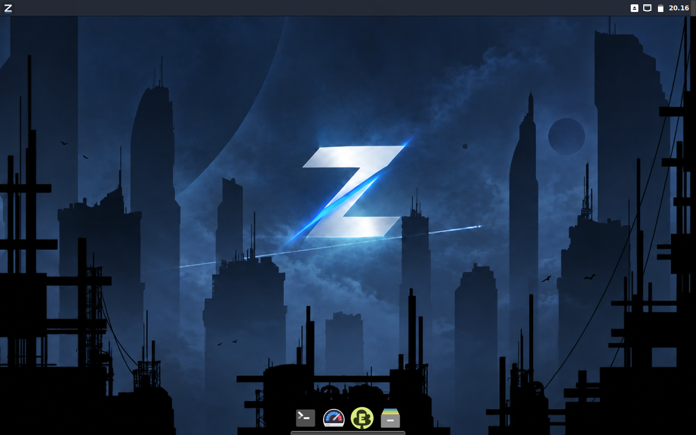
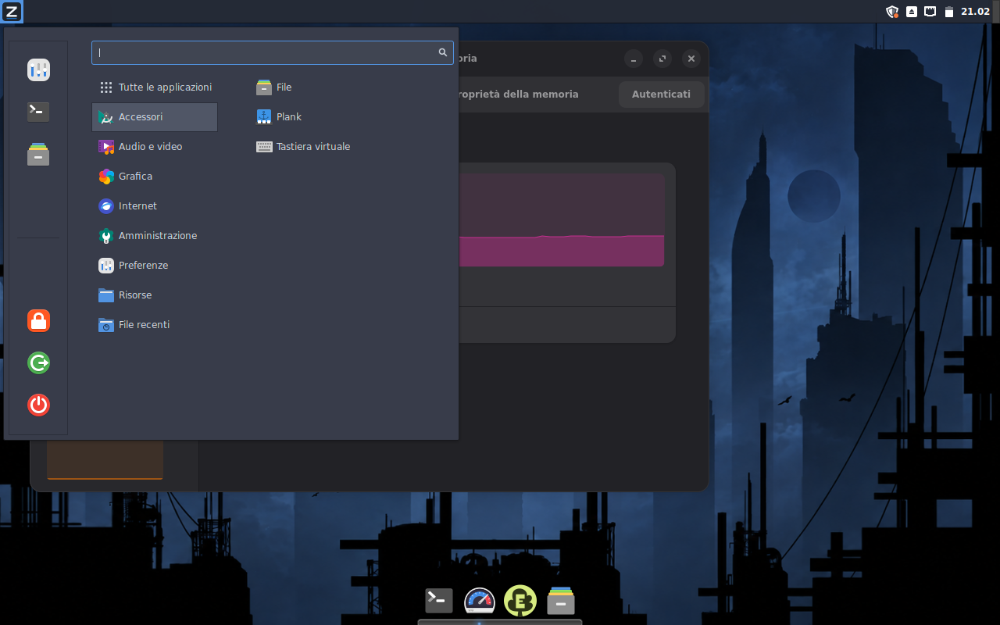
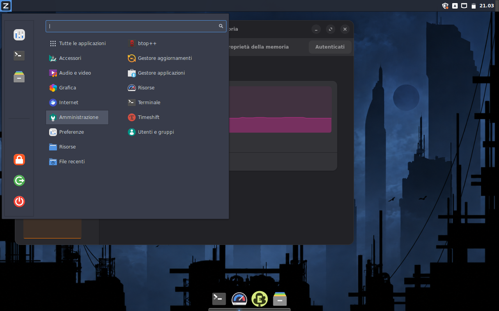
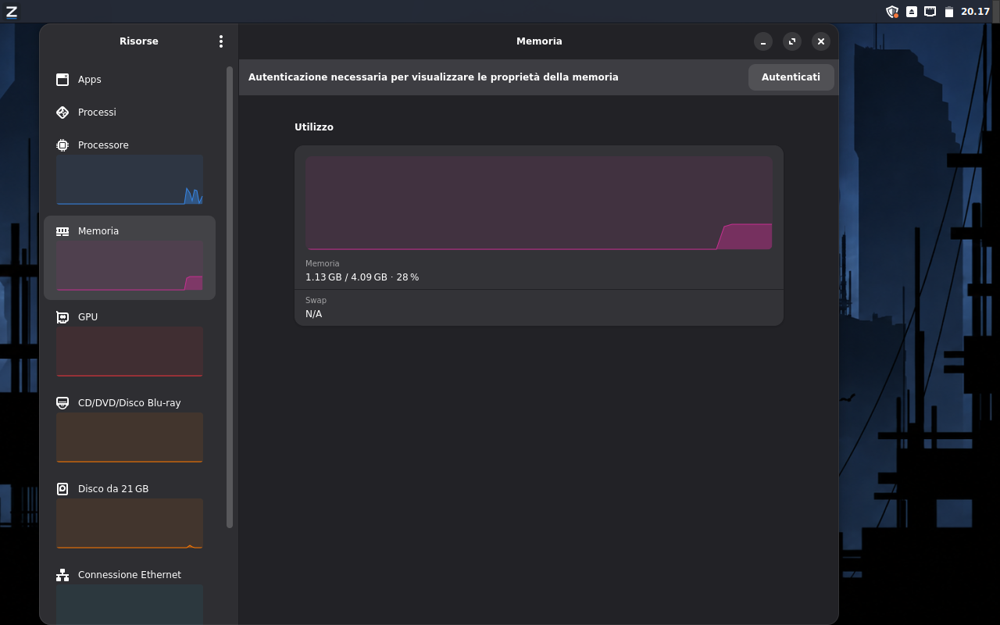
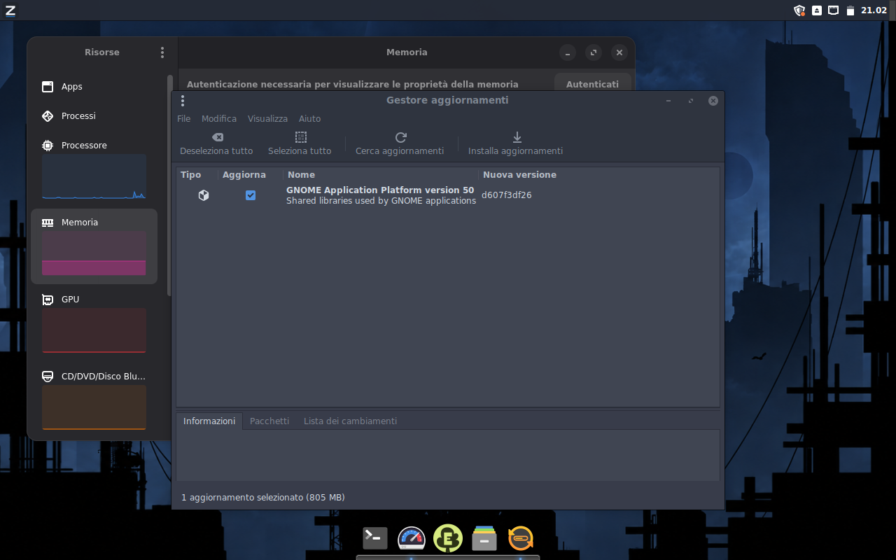
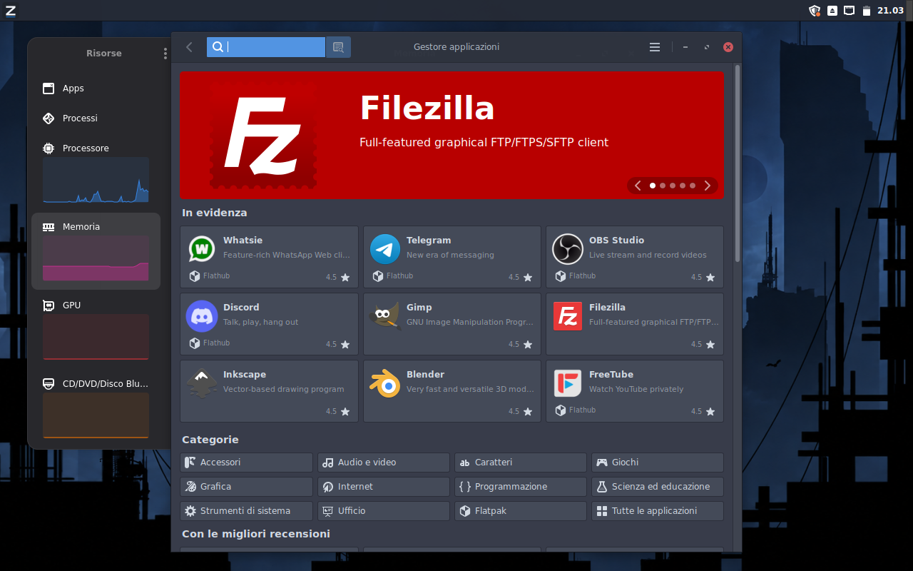
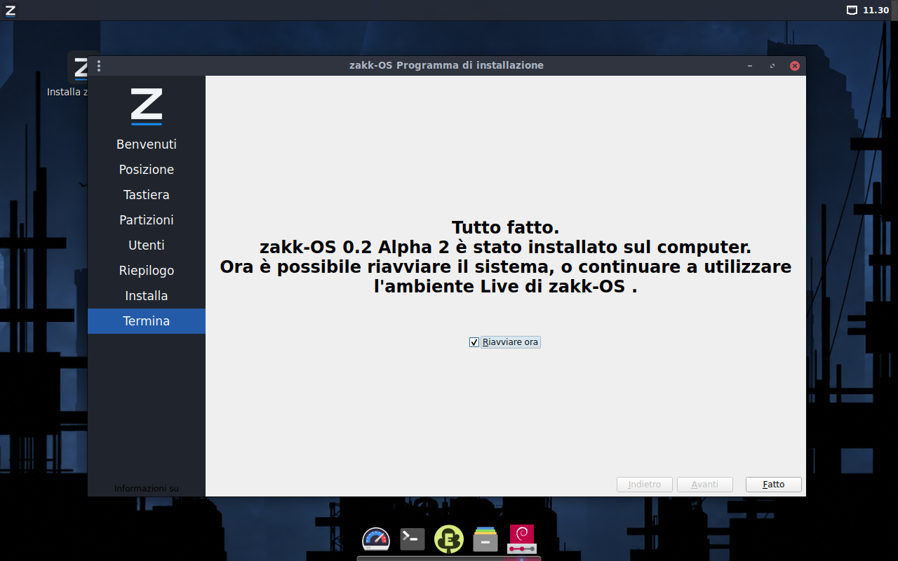

# zakk-OS

**Nasce per curiosità, cresce grazie alla condivisione e non prende ordini da nessuno.**

## ⚠️ NON È PER TUTTI. VERSIONE SPERIMENTALE. SOLO UEFI.

**Versione: 0.2 Alpha 2 — Experimental**

zakk-OS è una distribuzione Linux sperimentale basata su Debian 13 Trixie, con ambiente desktop Cinnamon.

Nasce come progetto personale per creare un sistema essenziale, personalizzabile e orientato alla futura integrazione dell'intelligenza artificiale locale.

**Non è una distribuzione stabile e non è destinata all'uso in produzione.**

## Screenshot della 0.2 Alpha 2

### Desktop Cinnamon

### Applicazioni e strumenti

| Menu applicazioni | Strumenti di amministrazione |
|:--:|:--:|
|  |  |

| Resources: monitoraggio del sistema | MintUpdate: aggiornamenti |
|:--:|:--:|
|  |  |

### Gestione software e installazione

| MintInstall con Flathub | Calamares: installazione completata |
|:--:|:--:|
|  |  |

*Immagini reali della versione 0.2 Alpha 2, acquisite durante i test.*

---

## 📥 Scarica zakk-OS 0.2 Alpha 2

**⚠️ VERSIONE SPERIMENTALE — SOLO UEFI**

[**⬇️ SCARICA LA ISO DI ZAKK-OS**](https://github.com/zakkos-yt/zakk-OS/releases/download/v0.2-alpha2/zakk-OS_0.2_alpha2.iso)

[Note di rilascio](https://github.com/zakkos-yt/zakk-OS/releases/tag/v0.2-alpha2) |
[Checksum SHA-256](https://github.com/zakkos-yt/zakk-OS/releases/download/v0.2-alpha2/zakk-OS_0.2_alpha2.iso.sha256)

**Non utilizzare su sistemi di produzione. Effettuare un backup prima dell'installazione.**

---

## Caratteristiche della Alpha 2

- Debian 13 Trixie, architettura AMD64
- Desktop Cinnamon con personalizzazioni grafiche
- Tema scuro e dock Plank
- Installatore grafico Calamares
- Avvio e installazione esclusivamente UEFI
- MintInstall e supporto Flatpak/Flathub
- MintUpdate
- Ecosia Browser
- Resources per monitorare il sistema
- Nemo, VLC, FFmpeg e altre utility essenziali
- Interfaccia preconfigurata in italiano

## Installazione

**ATTENZIONE: SOLO UEFI. BIOS Legacy NON supportato.**

Utilizzare preferibilmente una macchina virtuale o un computer dedicato ai test.

L'installazione su disco può cancellare definitivamente i dati. Effettuare sempre un backup prima di procedere.

## Hardware testato

- VirtualBox con avvio UEFI
- AMD Ryzen 5 3500X con NVIDIA RTX 2060 SUPER

Il funzionamento su queste configurazioni non garantisce compatibilità con altri sistemi.

## Problemi noti

- Possibili instabilità con il driver NVIDIA Nouveau
- Driver NVIDIA proprietari da installare manualmente
- Repository APT da integrare con `contrib` e `non-free`
- Stack audio PipeWire da installare/configurare manualmente
- Directory personali standard non sempre create automaticamente
- Firmware Realtek e supporto Wi-Fi da integrare
- Compatibilità hardware ancora in fase di verifica

## Funzionalità future

- zakk-OS Root, centro di controllo Rust/GTK4
- Installazione guidata dei driver grafici
- Gestione opzionale di Ollama
- Integrazione opzionale di Open WebUI e ComfyUI
- Ulteriori test hardware

## Sorgenti e compilazione

Il progetto utilizza Debian `live-build`.

Le configurazioni, gli script e le personalizzazioni sono presenti nel repository.

I Flatpak preinstallati, le cache e i file generati dalla build non sono inclusi nel repository Git.

**La ricostruzione integrale della ISO a partire dal solo repository non è ancora garantita**, perché alcuni componenti richiedono operazioni di staging non completamente automatizzate.

Per informazioni sui pacchetti esterni consultare la directory `manifests/`.

I componenti di terze parti mantengono le rispettive licenze.

## Avvertenze

Questa versione può contenere errori, crash, problemi di compatibilità e funzionalità incomplete.

Non utilizzarla per conservare dati importanti o per attività critiche.

zakk-OS è un progetto indipendente, non affiliato a Debian, Linux Mint o agli altri progetti utilizzati.

---

**Nasce per curiosità, cresce grazie alla condivisione e non prende ordini da nessuno.**

**… e non dimenticate che son cazzi vostri.**
